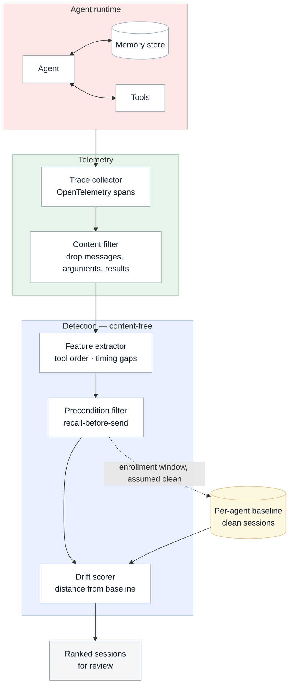

# Architecture — per-agent drift detector (Study 2)

Rendered view of [`architecture.mmd`](architecture.mmd). Edit the `.mmd` source, then copy it into the block below.

## Caption for `architecture.mmd`

> **Figure N.** Content-free drift detection. Agent activity is collected as
> OpenTelemetry spans; payload fields are dropped before feature extraction, so detection
> operates only on fields logged by default. The recall-before-send precondition narrows
> the candidate set, and a drift score against that agent's own baseline ranks what
> remains. Baseline sessions pass the same precondition, so candidates are compared
> against the matched population rather than against all prior activity. Cleanliness is
> established by the enrollment window rather than by the pipeline itself (dashed).
