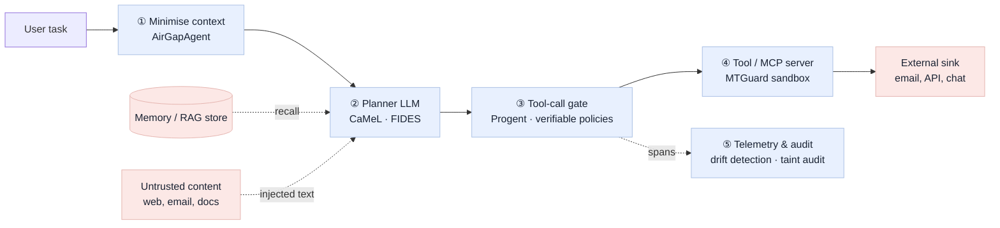

# Agentic DLP

Data loss prevention when the actor moving data is an AI agent, not a person. As of 2026-10-14.

Classic DLP watches files and channels a human uses. An agent moves data through **tool calls, memory and model output**, often with no human approving each step, and an attacker can steer it with text it merely reads. The literature on this has grown fast since 2023; this section organises it from a DLP point of view: *how does data leave through an agent, and where can it be stopped?*

## Contents

| Part | What's in it |
|---|---|
| [`01-threats.md`](01-threats.md) | Five ways data leaves through an agent, with the papers and incidents that show each |
| [`02-benchmarks.md`](02-benchmarks.md) | Benchmarks that measure agent data leakage, and what each one measures |
| [`03-defences.md`](03-defences.md) | Defences grouped by where they enforce: before context, at the planner, at the tool call, inside the tool, after the fact |
| [`04-standards-and-industry.md`](04-standards-and-industry.md) | OWASP Agentic Top 10 (2026), links to our ISO/NIST notes, what Korean DLP vendors cover |
| [`05-memory-poisoning.md`](05-memory-poisoning.md) | T3 in depth: 7 attacks, MPBench, 6 defences, and what they mean for the proposed drift idea (added 2026-10-29) |
| [`reading-list.csv`](reading-list.csv) | Every work cited here, with category and verification status |
| [`agent-behavioural-drift/`](agent-behavioural-drift/) | **Sub-strand:** detecting agent drift from content-free tool-call telemetry (Study 1 / Study 2) |

Related elsewhere in the repo: RAG-specific leakage is mapped on the [`rag-for-dlp`](https://github.com/alpacabar/dlp/tree/rag-for-dlp/rag-for-dlp) branch; vendor coverage of agent controls is in [`../existing-tools/`](../existing-tools/).

## Where agent DLP controls sit

Controls ①–④ act inline and need to see content; ⑤ acts after the fact and can work on metadata only. Our [`agent-behavioural-drift/`](agent-behavioural-drift/) strand sits at ⑤, in the content-free × cross-session cell.

## Taxonomy at a glance

| Threat category | Attacker needed? | Strongest evidence | Main defence family |
|---|---|---|---|
| T1 Injection-driven exfiltration | Yes, via content the agent reads | InjecAgent; EchoLeak (CVE-2025-32711) | IFC planners (CaMeL, FIDES); tool-call policy |
| T2 Tool and supply-chain poisoning | Yes, via tool metadata | MCP tool poisoning (Invariant Labs, 2025) | Tool pinning; sandbox monitoring (MTGuard) |
| T3 Memory and knowledge poisoning | Yes, planted earlier | AgentPoison; Trojan Hippo (exfiltration); Leong (delayed) | Write-time origin binding (TMA-NM); drift detection — see [`05`](05-memory-poisoning.md) |
| T4 Contextual over-sharing | **No** — the agent's own judgement | PrivacyLens; AgentDAM | Data minimisation (AirGapAgent) |
| T5 Multi-agent propagation | No / covert channels | Open challenges in multi-agent security | Largely open |

## Gaps that matter for our work

- **T4 needs no attacker**, so injection defences do not cover it; minimisation and contextual-integrity checks do. This is the closest fit to classic DLP and to ISO 27002 8.12, which covers disclosure by systems as well as individuals.
- **Strong defences need content** (CaMeL, FIDES, NeuroTaint). Under OpenTelemetry defaults content is not collected — the availability argument our drift strand builds on.
- **No domestic vendor fully mediates MCP tool calls or controls agent actions** (see `../existing-tools/`). Research prototypes exist (Progent, verifiable MCP policies, MTGuard); products do not yet.
- **Multi-agent leakage (T5)** has a problem statement and almost no benchmarks.
