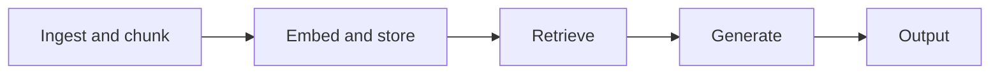

# Pipeline-stage map

Each RAG stage opens its own leak path and needs its own control.

| Stage | Data-loss threat (strand B) | DLP control (strands A, C) | Key works |
| --- | --- | --- | --- |
| Ingest and chunk | Raw PII and secrets enter the index; out-of-scope documents ingested | Classify and redact before indexing; attach lineage and clearance metadata | Zeng et al. 2024 · NerGuard, PRvL, DP-SynRAG |
| Embed and store | Embedding inversion recovers text; misconfigured or dumped vector DB | Local embedder, perturbed vectors; access control on the vector DB | Vec2Text, ALGEN, Zero2Text · TextCrafter |
| Retrieve | Over-broad or cross-tenant retrieval; membership inference via answers | Role or clearance filter on chunks; distance threshold on retrieval | Anderson et al. 2024, Riddle Me This · RBAC (Martinelli), Google TDC |
| Generate | Prompt injection makes the model repeat retrieved context verbatim | Local-DP gate or DP decoding; policy check before the LLM | Spill the Beans · VAGUE-Gate, DP token generation |
| Output | PII or secrets in the answer; regurgitated source documents | Output scan (regex, NER, LLM); verbatim-overlap check against context | PRvL leakage results · our dual-direction guardrail |

Retrieval and generation have the most published defences; embeddings and output have the fewest.
